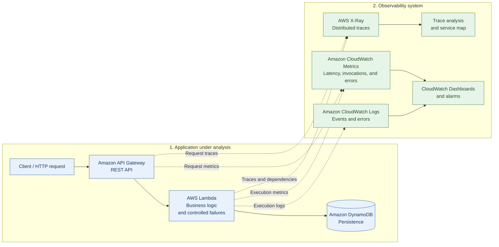
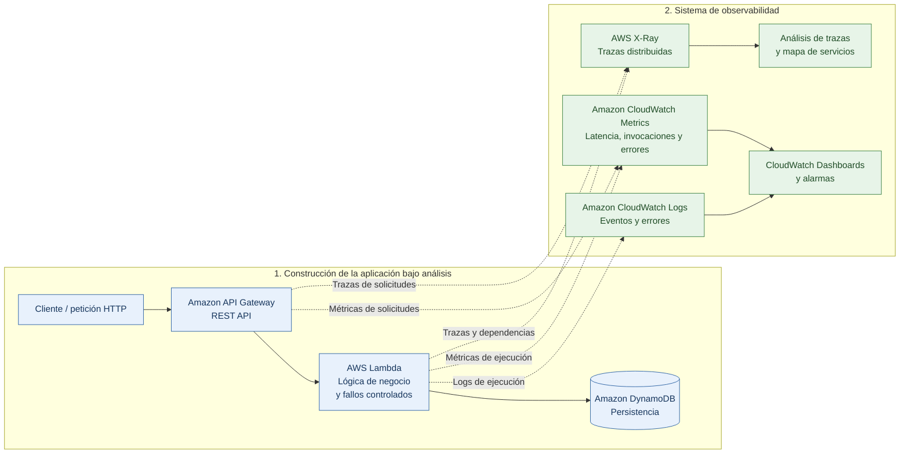

# From Bug to Insight: Observability 101 with AWS

Practical demo of observability applied to software quality. The repository shows how to investigate latency and errors in a serverless application with logs, metrics, and distributed traces.

[English](#english) · [Español](#espanol)

---

<a id="english"></a>

## English

### Session

| | |
|---|---|
| **Title** | From Bug to Insight: Observability 101 with AWS |
| **Goal** | Show how AWS observability services help detect, investigate, and diagnose software-quality problems with logs, metrics, and traces. |
| **Audience** | Level 100. Developers, testers, infrastructure professionals, and anyone interested in AWS. No prior observability experience is required. |
| **Duration** | 30 minutes |
| **Format** | Live demo (AWS User Group) |
| **Date** | To be defined |
| **Channel** | Hybrid |

### Summary

This repository supports a 30-minute demonstration that introduces observability applied to software quality. A serverless application built with Amazon API Gateway, AWS Lambda, and Amazon DynamoDB is observed with Amazon CloudWatch and AWS X-Ray to identify, investigate, and diagnose controlled failures and latency.

Software quality does not end with tests or with deployment. It also requires understanding how the application behaves while it runs. Through a reproducible scenario, the session shows how logs, metrics, and traces support evidence-based decisions and connect QA, development, and operations on AWS.

### Objectives

- Understand the three pillars of observability: logs, metrics, and traces.
- Tell monitoring the state of a system apart from investigating why an incident happened.
- Explore how serverless AWS services integrate with observability tools.
- Identify errors and anomalous behavior from evidence.
- Relate observability to software testing, incident diagnosis, and continuous quality improvement.

### Architecture

The application uses a serverless architecture on AWS. The diagram describes the target demonstration. The current template already defines the API, the Lambda functions, the DynamoDB table, JSON logging, and X-Ray tracing. Dashboards, alarms, and the controlled demo scenarios are preparation work before the session.



| Service | Responsibility |
|---|---|
| **Amazon API Gateway** | Exposes the HTTP endpoints and receives client requests. |
| **AWS Lambda** | Runs the business logic and is the place where normal behavior, controlled errors, and artificial latency will be reproduced. |
| **Amazon DynamoDB** | Stores the application data. |
| **Amazon CloudWatch Logs** | Collects execution records, events, and errors. |
| **Amazon CloudWatch Metrics** | Exposes indicators such as invocations, errors, and function duration. |
| **Amazon CloudWatch Dashboards** | Shows the relevant indicators together. Planned for the demo; not defined in the current template. |
| **Amazon CloudWatch Alarms** | Defines alert conditions on selected metrics. Planned for the demo; not defined in the current template. |
| **AWS X-Ray** | Examines distributed traces and helps locate the component to investigate. Enabled in the template for the API and the functions. |

The architecture and the scenarios are prepared before the session. The demo shows how to use these services. It does not build or deploy the infrastructure during the talk.

#### Resources defined in `template.yaml`

| Resource | Route | Handler |
|---|---|---|
| `getAllItemsFunction` | `GET /` | `src/handlers/get-all-items.getAllItemsHandler` |
| `getByIdFunction` | `GET /{id}` | `src/handlers/get-by-id.getByIdHandler` |
| `putItemFunction` | `POST /` | `src/handlers/put-item.putItemHandler` |
| `SampleTable` | — | DynamoDB table. Primary key: `id` (String). |

`Globals` enables active X-Ray tracing on every function, tracing on the API, and JSON logs through `LoggingConfig`.

### The three pillars

#### Logs: what happened?

Logs record events and execution details. They show what the application did during a request. In the demo they are used to identify a controlled error, review the context of one execution, and relate events to the observed behavior.

#### Metrics: how does the system behave?

Metrics show trends and deviations through quantifiable indicators. The demo reviews Lambda duration, invocation count, and errors to recognize when behavior moves away from the baseline.

#### Traces: where should we look?

Traces follow one request across the instrumented components. With AWS X-Ray, the demo inspects that path and looks for evidence that locates the component involved in an anomaly.

> Logs add context, metrics show behavior patterns, and traces help locate where to investigate. Each signal answers a different question.

### Demo scenarios

The application should reproduce three controlled situations:

1. **Normal operation.** Send requests and observe the expected API behavior.
2. **Controlled error.** Trigger a reproducible failure and identify the evidence it leaves in logs, metrics, and the available traces.
3. **Artificial latency.** Introduce a deliberate delay and see how it appears in request duration and in the traces.

Each scenario poses an investigation question, collects evidence, and separates conclusions that the signals support from conclusions that still need further checks.

Instrumentation and the final behavior of these scenarios must be validated before the demonstration is deployed. They are not implemented in the current handlers yet.

### Talk outline

Total time: **30 minutes**.

| Block | Time | Content |
|---|---:|---|
| Hook | 3 min | An API looks healthy and still has abnormal latency. How do we find the cause without reading all of the code? |
| Context | 5 min | Observability, its three pillars, and the difference between monitoring and investigating. |
| Main content | 5 min | Serverless architecture, observability services, and the link to software quality. |
| Live demo | 12 min | Normal requests, a controlled error or latency, then logs, metrics, and traces. |
| Conclusions | 2 min | Key takeaways and how observability applies to software quality. |
| Q&A | 3 min | Questions and practical uses. |

#### Live demo flow

1. Send a normal request and establish a baseline.
2. Introduce artificial latency or trigger a controlled error.
3. Open the logs in CloudWatch and identify the relevant events.
4. Review the metrics and spot the anomalous behavior.
5. Inspect the traces in X-Ray and investigate the involved component.
6. Relate the findings and explain how they would guide diagnosis and improvement.

### Software quality

Observability complements software testing because it examines behavior during execution, including situations that isolated tests do not always catch.

The collected evidence can help to:

- Compare real behavior with the expected result.
- Investigate defects and performance problems.
- Identify patterns that justify new tests.
- Make incidents easier to reproduce.
- Prioritize corrective action from evidence.
- Support collaboration between development, QA, and operations.

A successful HTTP response still has to be checked against the expected business outcome. Diagnosis uses both the technical signals and the behavior the application should have produced.

### Presentation prerequisites

- Application deployed and validated in AWS before the session.
- Access to the API endpoints.
- Read permissions for logs, metrics, dashboards, and traces.
- Normal, error, and latency scenarios prepared.
- Stable internet and access to the AWS console.
- Backup screenshots for the hybrid format, in case connectivity or the console fails.

Check permissions, sample data, and signal availability before the session. AWS X-Ray can sample requests, so a given invocation may not appear as a trace.

### Repository layout

This project contains the source code and supporting files for a serverless application that you can deploy with the [AWS SAM CLI](https://docs.aws.amazon.com/serverless-application-model/latest/developerguide/what-is-sam.html). It includes:

- `src` — code for the application's Lambda functions.
- `events` — invocation events you can use to invoke the functions.
- `__tests__` — unit tests for the application code.
- `template.yaml` — template that defines the application's AWS resources.

The application uses Lambda functions, an API Gateway API, and an Amazon DynamoDB table. These resources are defined in `template.yaml`. You can update the template to add AWS resources through the same deployment process that updates your application code.

If you prefer an IDE to build and test the application, you can use the AWS Toolkit. The AWS Toolkit is an open-source plugin for popular IDEs that uses the AWS SAM CLI to build and deploy serverless applications on AWS. It also adds step-through debugging for Lambda function code.

* [CLion](https://docs.aws.amazon.com/toolkit-for-jetbrains/latest/userguide/welcome.html)
* [GoLand](https://docs.aws.amazon.com/toolkit-for-jetbrains/latest/userguide/welcome.html)
* [IntelliJ](https://docs.aws.amazon.com/toolkit-for-jetbrains/latest/userguide/welcome.html)
* [WebStorm](https://docs.aws.amazon.com/toolkit-for-jetbrains/latest/userguide/welcome.html)
* [Rider](https://docs.aws.amazon.com/toolkit-for-jetbrains/latest/userguide/welcome.html)
* [PhpStorm](https://docs.aws.amazon.com/toolkit-for-jetbrains/latest/userguide/welcome.html)
* [PyCharm](https://docs.aws.amazon.com/toolkit-for-jetbrains/latest/userguide/welcome.html)
* [RubyMine](https://docs.aws.amazon.com/toolkit-for-jetbrains/latest/userguide/welcome.html)
* [DataGrip](https://docs.aws.amazon.com/toolkit-for-jetbrains/latest/userguide/welcome.html)
* [VS Code](https://docs.aws.amazon.com/toolkit-for-vscode/latest/userguide/welcome.html)
* [Visual Studio](https://docs.aws.amazon.com/toolkit-for-visual-studio/latest/user-guide/welcome.html)

### Local requirements

- [AWS CLI](https://docs.aws.amazon.com/cli/latest/userguide/getting-started-install.html)
- [AWS SAM CLI](https://docs.aws.amazon.com/serverless-application-model/latest/developerguide/serverless-sam-cli-install.html)
- [Node.js 24](https://nodejs.org/en/), including npm. This matches the `nodejs24.x` runtime in the template.
- [Docker Community Edition](https://hub.docker.com/search/?type=edition&offering=community), used by the SAM CLI to run functions locally.
- Git

AWS credentials are required for operations that talk to your account. Unit tests and template validation can run locally without deploying the infrastructure.

### Validate and build

From the repository root. These commands do not deploy the application.

```powershell
sam validate
sam build
pnpm test
```

- `sam validate` checks the SAM template.
- `sam build` prepares the build artifacts. The SAM CLI installs the dependencies defined in `package.json`, creates a deployment package, and saves it in `.aws-sam/build`.
- `pnpm test` runs the unit tests. The test script is defined in `package.json` and uses [Jest](https://jestjs.io/). Install dependencies first with `pnpm install` if `node_modules` is missing.

Verify the test result before treating the project as ready for the presentation.

### Deploy the sample application

The AWS SAM CLI is an extension of the AWS CLI that adds functionality for building and testing Lambda applications. It uses Docker to run your functions in an Amazon Linux environment that matches Lambda. It can also emulate your application's build environment and API.

Review the generated CloudFormation template, the IAM permissions, and the expected budget before the first deploy. See [Costs and security](#costs-and-security).

To build and deploy the application for the first time, run the following in your shell:

```bash
sam build
sam deploy --guided
```

The first command builds the source of your application. The second command packages and deploys your application to AWS, with a series of prompts:

* **Stack Name**: The name of the stack to deploy to CloudFormation. This should be unique to your account and region. A good starting point is a name that matches the project, such as `observability-101-with-aws`.
* **AWS Region**: The AWS region you want to deploy your app to.
* **Confirm changes before deploy**: If set to yes, any change sets will be shown to you before execution for manual review. If set to no, the AWS SAM CLI will automatically deploy application changes.
* **Allow SAM CLI IAM role creation**: Many AWS SAM templates, including this example, create AWS IAM roles required for the Lambda functions to access AWS services. By default, these are scoped down to the minimum required permissions. To deploy an AWS CloudFormation stack which creates or modifies IAM roles, the `CAPABILITY_IAM` value for `capabilities` must be provided. If permission is not provided through this prompt, you must explicitly pass `--capabilities CAPABILITY_IAM` to `sam deploy`.
* **Save arguments to samconfig.toml**: If set to yes, your choices will be saved to a configuration file inside the project, so that later you can re-run `sam deploy` without parameters to deploy changes.

The API Gateway endpoint URL is displayed in the outputs when the deployment is complete (`WebEndpoint`).

### Use the AWS SAM CLI to build and test locally

Test a single function by invoking it directly with a test event. An event is a JSON document that represents the input that the function receives from the event source. Test events are included in the `events` folder.

Update `env.json` to include the physical ID of the DynamoDB table:

```json
{
    "getAllItemsFunction": {
        "SAMPLE_TABLE": "<mystack-mytable>"
    },
    "getByIdFunction": {
        "SAMPLE_TABLE": "<mystack-mytable>"
    },
    "putItemFunction": {
        "SAMPLE_TABLE": "<mystack-mytable>"
    }
}
```

Run functions locally and invoke them with `sam local invoke`:

```bash
sam local invoke putItemFunction --event events/event-post-item.json --env-vars env.json
sam local invoke getAllItemsFunction --event events/event-get-all-items.json --env-vars env.json
```

The AWS SAM CLI can also emulate your application's API. Use `sam local start-api` to run the API locally on port 3000.

```bash
sam local start-api
curl http://localhost:3000/
```

The AWS SAM CLI reads the application template to determine the API's routes and the functions that they invoke. The `Events` property on each function's definition includes the route and method for each path.

```yaml
Events:
  Api:
    Type: Api
    Properties:
      Path: /
      Method: GET
```

### Test locally with DynamoDB

1. Start DynamoDB Local in a Docker container (this example works on a codespace):

```bash
docker run --rm -p 8000:8000 -v /tmp:/data amazon/dynamodb-local
```

2. Start the local API:

```bash
sam local start-api --env-vars env.json --host 0.0.0.0 --debug
```

3. Create the local DynamoDB table:

```bash
aws dynamodb create-table --table-name SampleTable --attribute-definitions AttributeName=id,AttributeType=S --key-schema AttributeName=id,KeyType=HASH --billing-mode PAY_PER_REQUEST --endpoint-url http://127.0.0.1:8000
```

4. Put an item into DynamoDB Local:

```bash
aws dynamodb put-item \
    --table-name SampleTable \
    --item '{"id": {"S": "A1234"}, "name": {"S": "randeepx"}}' \
    --endpoint-url http://127.0.0.1:8000
```

5. Scan the table to check the item you inserted:

```bash
aws dynamodb scan --table-name SampleTable --endpoint-url http://127.0.0.1:8000
```

### Add a resource to your application

The application template uses AWS SAM to define application resources. AWS SAM is an extension of AWS CloudFormation with a simpler syntax for configuring common serverless application resources, such as functions, triggers, and APIs. For resources that are not included in the [AWS SAM specification](https://github.com/awslabs/serverless-application-model/blob/master/versions/2016-10-31.md), you can use the standard [AWS CloudFormation resource types](https://docs.aws.amazon.com/AWSCloudFormation/latest/UserGuide/aws-template-resource-type-ref.html).

Update `template.yaml` to add a dead-letter queue to your application. In the **Resources** section, add a resource named **MyQueue** with the type **AWS::SQS::Queue**. Then add a property to the **AWS::Serverless::Function** resource named **DeadLetterQueue** that targets the queue's Amazon Resource Name (ARN), and a policy that grants the function permission to access the queue.

```yaml
Resources:
  MyQueue:
    Type: AWS::SQS::Queue
  getAllItemsFunction:
    Type: AWS::Serverless::Function
    Properties:
      Handler: src/handlers/get-all-items.getAllItemsHandler
      Runtime: nodejs24.x
      DeadLetterQueue:
        Type: SQS
        TargetArn: !GetAtt MyQueue.Arn
      Policies:
        - SQSSendMessagePolicy:
            QueueName: !GetAtt MyQueue.QueueName
```

The dead-letter queue is a location for Lambda to send events that could not be processed. It is only used if you invoke your function asynchronously, and it is included here to show how you can modify your application's resources and function configuration.

Deploy the updated application.

```bash
sam deploy
```

Open the [**Applications**](https://console.aws.amazon.com/lambda/home#/applications) page of the Lambda console, and choose your application. When the deployment completes, view the application resources on the **Overview** tab to see the new resource. Then, choose the function to see the updated configuration that specifies the dead-letter queue.

### Fetch, tail, and filter Lambda function logs

To simplify troubleshooting, the AWS SAM CLI has a command called `sam logs`. `sam logs` fetches logs generated by your Lambda function from the command line. In addition to printing the logs on the terminal, this command has several features to help you find a problem quickly.

This command works for all Lambda functions, not just the ones you deploy using AWS SAM.

```bash
sam logs -n putItemFunction --stack-name observability-101-with-aws --tail
```

This uses the logical name of the function within the stack. That is the name to use when searching logs for a Lambda function inside a CloudFormation stack, even if the deployed function name varies because CloudFormation generates a unique physical name.

You can find more information and examples about filtering Lambda function logs in the [AWS SAM CLI documentation](https://docs.aws.amazon.com/serverless-application-model/latest/developerguide/serverless-sam-cli-logging.html).

### Unit tests

Tests are defined in the `__tests__` folder. Use pnpm to install dependencies and run the unit tests.

```bash
pnpm install
pnpm test
```

### Cleanup

To delete the sample application that you created, use the AWS SAM CLI. If you used the project name for the stack name, you can run:

```bash
sam delete --stack-name observability-101-with-aws
```

### Costs and security

The project is a bounded demonstration, with controlled requests and minimal resources.

Before deploying:

- Review the CloudFormation template generated by SAM.
- Check that the IAM permissions follow least privilege.
- Estimate the cost of API Gateway, Lambda, DynamoDB, CloudWatch, and X-Ray.
- Configure budget alerts and review actual cost during rehearsals.
- Avoid large volumes of logs or unnecessary requests.
- Delete the test resources when you no longer need them.

Promotional credits, when available, are not a guarantee of zero cost. Budget alerts do not automatically stop charges.

**Do not deploy until you have reviewed the infrastructure, the permissions, and the expected budget.**

### Resources

For an introduction to the AWS SAM specification, the AWS SAM CLI, and serverless application concepts, see the [AWS SAM Developer Guide](https://docs.aws.amazon.com/serverless-application-model/latest/developerguide/what-is-sam.html).

You can use the AWS Serverless Application Repository to deploy ready-to-use apps that go beyond Hello World samples and learn how authors developed their applications. For more information, see the [AWS Serverless Application Repository main page](https://aws.amazon.com/serverless/serverlessrepo/) and the [AWS Serverless Application Repository Developer Guide](https://docs.aws.amazon.com/serverlessrepo/latest/devguide/what-is-serverlessrepo.html).

### Expected outcome

By the end of the talk, attendees should understand how to use the basic AWS observability services to investigate a reproducible latency or error problem.

The demonstration reinforces that software quality continues after tests and deployment: it requires observing application behavior, interpreting evidence, and making informed decisions to improve reliability.

### Project status

The repository starts from an AWS SAM template with Lambda functions, HTTP endpoints, a DynamoDB table, and the initial logging and tracing configuration described above.

Adapting the demo scenarios, validating the observability signals, reviewing permissions, and performing a controlled deployment are preparation work before the presentation.

---

<a id="espanol"></a>

## Español

### Sesión

| | |
|---|---|
| **Título** | From Bug to Insight: Observability 101 with AWS |
| **Objetivo** | Demostrar cómo los servicios de observabilidad de AWS permiten detectar, investigar y diagnosticar problemas de calidad de software mediante logs, métricas y trazas. |
| **Audiencia** | Nivel 100. Desarrolladores, testers, profesionales de infraestructura y personas interesadas en AWS. No se requiere experiencia previa en observabilidad. |
| **Duración** | 30 minutos |
| **Formato** | Demo en vivo (AWS User Group) |
| **Fecha** | Por definir |
| **Canal** | Híbrida |

### Resumen

Este repositorio apoya una demostración de 30 minutos que introduce la observabilidad aplicada a la calidad del software. Una aplicación serverless construida con Amazon API Gateway, AWS Lambda y Amazon DynamoDB se observa con Amazon CloudWatch y AWS X-Ray para identificar, investigar y diagnosticar fallos y problemas de latencia controlados.

La calidad del software no termina con las pruebas ni con el despliegue. También requiere comprender el comportamiento de la aplicación mientras se ejecuta. Mediante un escenario reproducible, la sesión muestra cómo los logs, las métricas y las trazas permiten tomar decisiones basadas en evidencia y conectar las prácticas de QA, desarrollo y operaciones en AWS.

### Objetivos

- Comprender los tres pilares de la observabilidad: logs, métricas y trazas.
- Diferenciar la monitorización del estado de un sistema de la investigación de las causas de un incidente.
- Explorar la integración de servicios serverless de AWS con herramientas de observabilidad.
- Identificar errores y comportamientos anómalos a partir de evidencia.
- Relacionar la observabilidad con las pruebas de software, el diagnóstico de incidentes y la mejora continua de la calidad.

### Arquitectura

La aplicación utiliza una arquitectura serverless en AWS. El diagrama describe la demostración prevista. La plantilla actual ya define la API, las funciones Lambda, la tabla de DynamoDB, el logging en JSON y el rastreo con X-Ray. Los dashboards, las alarmas y los escenarios controlados de la demo forman parte de la preparación previa a la sesión.



| Servicio | Responsabilidad |
|---|---|
| **Amazon API Gateway** | Expone los endpoints HTTP y recibe las solicitudes de los clientes. |
| **AWS Lambda** | Ejecuta la lógica de negocio y es el lugar donde se reproducirán el funcionamiento normal, los errores controlados y la latencia artificial. |
| **Amazon DynamoDB** | Almacena los datos de la aplicación. |
| **Amazon CloudWatch Logs** | Centraliza los registros de ejecución, eventos y errores. |
| **Amazon CloudWatch Metrics** | Permite analizar indicadores como invocaciones, errores y duración de las funciones. |
| **Amazon CloudWatch Dashboards** | Facilita la visualización conjunta de indicadores relevantes. Previsto para la demo; no está definido en la plantilla actual. |
| **Amazon CloudWatch Alarms** | Permite definir condiciones de alerta sobre métricas seleccionadas. Previsto para la demo; no está definido en la plantilla actual. |
| **AWS X-Ray** | Permite examinar las trazas distribuidas y localizar el componente que requiere investigación. Está habilitado en la plantilla para la API y las funciones. |

La arquitectura y los escenarios se preparan antes de la sesión. La demo muestra el uso de estos servicios. No construye ni despliega la infraestructura durante la charla.

#### Recursos definidos en `template.yaml`

| Recurso | Ruta | Handler |
|---|---|---|
| `getAllItemsFunction` | `GET /` | `src/handlers/get-all-items.getAllItemsHandler` |
| `getByIdFunction` | `GET /{id}` | `src/handlers/get-by-id.getByIdHandler` |
| `putItemFunction` | `POST /` | `src/handlers/put-item.putItemHandler` |
| `SampleTable` | — | Tabla de DynamoDB. Clave primaria: `id` (String). |

`Globals` activa el rastreo de X-Ray en cada función, el rastreo de la API y los logs en JSON mediante `LoggingConfig`.

### Los tres pilares de la observabilidad

#### Logs: ¿qué ocurrió?

Los logs registran eventos y detalles de ejecución. Muestran qué hizo la aplicación durante una solicitud. En la demostración se utilizan para identificar un error controlado, revisar el contexto de una ejecución y relacionar los eventos con el comportamiento observado.

#### Métricas: ¿cómo se comporta el sistema?

Las métricas permiten observar tendencias y detectar desviaciones mediante indicadores cuantificables. En la demo se revisan la duración de las funciones Lambda, el número de invocaciones y los errores para reconocer cuándo el comportamiento se aleja del punto de referencia.

#### Trazas: ¿dónde investigar?

Las trazas permiten seguir una solicitud a través de los componentes instrumentados. Con AWS X-Ray se examina ese recorrido y se buscan indicios que localicen el componente involucrado en una anomalía.

> Los logs aportan contexto, las métricas muestran patrones de comportamiento y las trazas ayudan a localizar dónde investigar. Cada señal responde una pregunta distinta.

### Escenarios de demostración

La aplicación deberá permitir reproducir tres situaciones controladas:

1. **Funcionamiento normal.** Ejecutar solicitudes y observar el comportamiento esperado de la API.
2. **Error controlado.** Provocar un fallo reproducible e identificar las evidencias que deja en los logs, las métricas y las trazas disponibles.
3. **Latencia artificial.** Introducir un retraso deliberado y analizar cómo se refleja en la duración de las solicitudes y en las trazas.

Cada escenario sirve para formular una pregunta de investigación, recopilar evidencia y separar las conclusiones que las señales sustentan de las que aún requieren comprobaciones adicionales.

La instrumentación y el comportamiento definitivos de estos escenarios deben validarse antes de desplegar la demostración. Todavía no están implementados en los handlers actuales.

### Guion de la charla

Duración total: **30 minutos**.

| Bloque | Duración | Contenido |
|---|---:|---|
| Hook | 3 min | Una API parece funcionar bien y, aun así, tiene una latencia anormal. ¿Cómo encontrar la causa sin revisar todo el código? |
| Contexto | 5 min | Introducción a la observabilidad, sus tres pilares y la diferencia entre monitorizar e investigar. |
| Contenido principal | 5 min | Arquitectura serverless, servicios de observabilidad y relación con la calidad del software. |
| Demo en vivo | 12 min | Solicitudes normales, error o latencia controlada, y análisis de logs, métricas y trazas. |
| Conclusiones | 2 min | Aprendizajes clave y aplicación de la observabilidad a la calidad del software. |
| Q&A | 3 min | Preguntas y discusión sobre aplicaciones prácticas. |

#### Flujo de la demostración en vivo

1. Ejecutar una solicitud normal y establecer un punto de referencia.
2. Introducir una latencia artificial o provocar un error controlado.
3. Consultar los logs en CloudWatch e identificar eventos relevantes.
4. Revisar las métricas para detectar el comportamiento anómalo.
5. Inspeccionar las trazas en X-Ray para investigar el componente involucrado.
6. Relacionar los hallazgos y explicar cómo orientarían el diagnóstico y las acciones de mejora.

### Relación con la calidad del software

La observabilidad complementa las pruebas de software porque permite examinar el comportamiento de una aplicación durante su ejecución, incluidas situaciones que no siempre se detectan en pruebas aisladas.

La evidencia recopilada puede ayudar a:

- Contrastar el comportamiento real con el resultado esperado.
- Investigar defectos y problemas de rendimiento.
- Identificar patrones que justifiquen nuevas pruebas.
- Mejorar la reproducibilidad de los incidentes.
- Priorizar acciones correctivas con base en evidencia.
- Facilitar la colaboración entre desarrollo, QA y operaciones.

Una respuesta HTTP exitosa todavía debe contrastarse con el resultado de negocio esperado. El diagnóstico considera tanto las señales técnicas como el comportamiento que la aplicación debería haber producido.

### Prerrequisitos para la presentación

- Aplicación desplegada y validada en AWS antes de la sesión.
- Acceso a los endpoints de la API.
- Permisos de lectura para consultar logs, métricas, dashboards y trazas.
- Escenarios de funcionamiento normal, error y latencia preparados.
- Conexión a internet estable y acceso a la consola de AWS.
- Capturas de pantalla de respaldo para el formato híbrido, ante problemas de conectividad o de la consola.

Conviene verificar los permisos, los datos de ejemplo y la disponibilidad de las señales de observabilidad antes de la sesión. AWS X-Ray puede muestrear las solicitudes, así que una invocación concreta puede no aparecer como traza.

### Estructura del repositorio

Este proyecto contiene el código fuente y los archivos de apoyo de una aplicación serverless que se puede desplegar con la [AWS SAM CLI](https://docs.aws.amazon.com/serverless-application-model/latest/developerguide/what-is-sam.html). Incluye:

- `src` — código de las funciones Lambda.
- `events` — eventos de invocación para probar las funciones.
- `__tests__` — pruebas unitarias del código de la aplicación.
- `template.yaml` — plantilla que define los recursos de AWS de la aplicación.

La aplicación usa funciones Lambda, una API de API Gateway y una tabla de Amazon DynamoDB. Estos recursos están definidos en `template.yaml`. La misma plantilla sirve para añadir recursos de AWS y para actualizar el código de la aplicación.

Si prefieres un IDE para construir y probar la aplicación, puedes usar AWS Toolkit. AWS Toolkit es un complemento de código abierto para IDEs habituales que utiliza la AWS SAM CLI para construir y desplegar aplicaciones serverless en AWS. También añade depuración paso a paso del código de las funciones Lambda.

* [CLion](https://docs.aws.amazon.com/toolkit-for-jetbrains/latest/userguide/welcome.html)
* [GoLand](https://docs.aws.amazon.com/toolkit-for-jetbrains/latest/userguide/welcome.html)
* [IntelliJ](https://docs.aws.amazon.com/toolkit-for-jetbrains/latest/userguide/welcome.html)
* [WebStorm](https://docs.aws.amazon.com/toolkit-for-jetbrains/latest/userguide/welcome.html)
* [Rider](https://docs.aws.amazon.com/toolkit-for-jetbrains/latest/userguide/welcome.html)
* [PhpStorm](https://docs.aws.amazon.com/toolkit-for-jetbrains/latest/userguide/welcome.html)
* [PyCharm](https://docs.aws.amazon.com/toolkit-for-jetbrains/latest/userguide/welcome.html)
* [RubyMine](https://docs.aws.amazon.com/toolkit-for-jetbrains/latest/userguide/welcome.html)
* [DataGrip](https://docs.aws.amazon.com/toolkit-for-jetbrains/latest/userguide/welcome.html)
* [VS Code](https://docs.aws.amazon.com/toolkit-for-vscode/latest/userguide/welcome.html)
* [Visual Studio](https://docs.aws.amazon.com/toolkit-for-visual-studio/latest/user-guide/welcome.html)

### Requisitos locales

- [AWS CLI](https://docs.aws.amazon.com/cli/latest/userguide/getting-started-install.html)
- [AWS SAM CLI](https://docs.aws.amazon.com/serverless-application-model/latest/developerguide/serverless-sam-cli-install.html)
- [Node.js 24](https://nodejs.org/en/), incluido npm. Coincide con el runtime `nodejs24.x` de la plantilla.
- [Docker Community Edition](https://hub.docker.com/search/?type=edition&offering=community), que la SAM CLI usa para ejecutar las funciones en local.
- Git

Las credenciales de AWS son necesarias para las operaciones que interactúan con la cuenta. Las pruebas unitarias y la validación de la plantilla pueden ejecutarse en local sin desplegar la infraestructura.

### Validar y construir

Desde la raíz del repositorio. Estos comandos no despliegan la aplicación.

```powershell
sam validate
sam build
pnpm test
```

- `sam validate` valida la plantilla SAM.
- `sam build` prepara los artefactos de construcción. La SAM CLI instala las dependencias definidas en `package.json`, crea el paquete de despliegue y lo guarda en `.aws-sam/build`.
- `pnpm test` ejecuta las pruebas unitarias. El script está definido en `package.json` y usa [Jest](https://jestjs.io/). Si falta `node_modules`, instala las dependencias antes con `pnpm install`.

El resultado de las pruebas debe verificarse antes de considerar listo el proyecto para la presentación.

### Desplegar la aplicación de ejemplo

La AWS SAM CLI amplía la AWS CLI con funciones para construir y probar aplicaciones Lambda. Usa Docker para ejecutar las funciones en un entorno Amazon Linux equivalente al de Lambda. También puede emular el entorno de construcción y la API de la aplicación.

Antes del primer despliegue, revisa la plantilla de CloudFormation generada, los permisos IAM y el presupuesto previsto. Consulta [Costos y seguridad](#costos-y-seguridad).

Para construir y desplegar la aplicación por primera vez, ejecuta lo siguiente:

```bash
sam build
sam deploy --guided
```

El primer comando construye el código de la aplicación. El segundo empaqueta y despliega la aplicación en AWS, con estas preguntas:

* **Stack Name**: nombre de la pila en CloudFormation. Debe ser único en tu cuenta y región. Un buen punto de partida es un nombre alineado con el proyecto, como `observability-101-with-aws`.
* **AWS Region**: región de AWS en la que quieres desplegar la aplicación.
* **Confirm changes before deploy**: si respondes que sí, los change sets se muestran antes de ejecutarse para una revisión manual. Si respondes que no, la SAM CLI despliega los cambios automáticamente.
* **Allow SAM CLI IAM role creation**: muchas plantillas SAM, incluida esta, crean roles de IAM para que las funciones Lambda accedan a servicios de AWS. Por defecto, esos permisos se limitan al mínimo necesario. Para desplegar una pila de CloudFormation que crea o modifica roles de IAM, hay que indicar `CAPABILITY_IAM`. Si no se concede en esta pregunta, hay que pasar `--capabilities CAPABILITY_IAM` a `sam deploy`.
* **Save arguments to samconfig.toml**: si respondes que sí, las opciones se guardan en un archivo de configuración del proyecto. Después puedes volver a ejecutar `sam deploy` sin parámetros para desplegar cambios.

Al terminar el despliegue, la URL del endpoint de API Gateway aparece en las salidas (`WebEndpoint`).

### Construir y probar en local con la AWS SAM CLI

Puedes probar una función invocándola directamente con un evento de prueba. Un evento es un documento JSON que representa la entrada que la función recibe del origen del evento. Los eventos de prueba están en la carpeta `events`.

Actualiza `env.json` con el ID físico de la tabla de DynamoDB:

```json
{
    "getAllItemsFunction": {
        "SAMPLE_TABLE": "<mystack-mytable>"
    },
    "getByIdFunction": {
        "SAMPLE_TABLE": "<mystack-mytable>"
    },
    "putItemFunction": {
        "SAMPLE_TABLE": "<mystack-mytable>"
    }
}
```

Ejecuta las funciones en local con `sam local invoke`:

```bash
sam local invoke putItemFunction --event events/event-post-item.json --env-vars env.json
sam local invoke getAllItemsFunction --event events/event-get-all-items.json --env-vars env.json
```

La AWS SAM CLI también puede emular la API de la aplicación. `sam local start-api` la levanta en el puerto 3000.

```bash
sam local start-api
curl http://localhost:3000/
```

La SAM CLI lee la plantilla para determinar las rutas de la API y las funciones que invocan. La propiedad `Events` de cada función incluye la ruta y el método.

```yaml
Events:
  Api:
    Type: Api
    Properties:
      Path: /
      Method: GET
```

### Probar en local con DynamoDB

1. Inicia DynamoDB Local en un contenedor de Docker (este ejemplo funciona en un codespace):

```bash
docker run --rm -p 8000:8000 -v /tmp:/data amazon/dynamodb-local
```

2. Inicia la API local:

```bash
sam local start-api --env-vars env.json --host 0.0.0.0 --debug
```

3. Crea la tabla local de DynamoDB:

```bash
aws dynamodb create-table --table-name SampleTable --attribute-definitions AttributeName=id,AttributeType=S --key-schema AttributeName=id,KeyType=HASH --billing-mode PAY_PER_REQUEST --endpoint-url http://127.0.0.1:8000
```

4. Inserta un elemento en DynamoDB Local:

```bash
aws dynamodb put-item \
    --table-name SampleTable \
    --item '{"id": {"S": "A1234"}, "name": {"S": "randeepx"}}' \
    --endpoint-url http://127.0.0.1:8000
```

5. Haz un scan de la tabla para comprobar el elemento insertado:

```bash
aws dynamodb scan --table-name SampleTable --endpoint-url http://127.0.0.1:8000
```

### Añadir un recurso a la aplicación

La plantilla usa AWS SAM para definir los recursos. AWS SAM es una extensión de AWS CloudFormation con una sintaxis más simple para recursos habituales de aplicaciones serverless, como funciones, desencadenadores y APIs. Para recursos que no forman parte de la [especificación de AWS SAM](https://github.com/awslabs/serverless-application-model/blob/master/versions/2016-10-31.md), se pueden usar los [tipos de recurso estándar de AWS CloudFormation](https://docs.aws.amazon.com/AWSCloudFormation/latest/UserGuide/aws-template-resource-type-ref.html).

Actualiza `template.yaml` para añadir una cola de mensajes fallidos (dead-letter queue). En la sección **Resources**, añade un recurso llamado **MyQueue** de tipo **AWS::SQS::Queue**. Después añade a la función **AWS::Serverless::Function** una propiedad **DeadLetterQueue** que apunte al ARN de la cola, y una política que conceda a la función permiso para acceder a ella.

```yaml
Resources:
  MyQueue:
    Type: AWS::SQS::Queue
  getAllItemsFunction:
    Type: AWS::Serverless::Function
    Properties:
      Handler: src/handlers/get-all-items.getAllItemsHandler
      Runtime: nodejs24.x
      DeadLetterQueue:
        Type: SQS
        TargetArn: !GetAtt MyQueue.Arn
      Policies:
        - SQSSendMessagePolicy:
            QueueName: !GetAtt MyQueue.QueueName
```

La cola de mensajes fallidos es el destino al que Lambda envía los eventos que no pudo procesar. Solo se usa si invocas la función de forma asíncrona, y aquí sirve para mostrar cómo modificar los recursos y la configuración de la función.

Despliega la aplicación actualizada.

```bash
sam deploy
```

Abre la página [**Applications**](https://console.aws.amazon.com/lambda/home#/applications) de la consola de Lambda y elige tu aplicación. Cuando termine el despliegue, revisa los recursos en la pestaña **Overview**. Después abre la función para ver la configuración actualizada con la cola de mensajes fallidos.

### Consultar, seguir y filtrar logs de Lambda

Para simplificar el diagnóstico, la AWS SAM CLI incluye el comando `sam logs`. `sam logs` obtiene desde la línea de comandos los logs generados por una función Lambda. Además de imprimirlos en la terminal, ofrece opciones para localizar un problema con rapidez.

El comando funciona con cualquier función Lambda, no solo con las desplegadas mediante AWS SAM.

```bash
sam logs -n putItemFunction --stack-name observability-101-with-aws --tail
```

Aquí se usa el nombre lógico de la función dentro de la pila. Es el nombre correcto para buscar logs de una función Lambda dentro de una pila de CloudFormation, aunque el nombre físico desplegado cambie por la generación de nombres de CloudFormation.

Hay más información y ejemplos de filtrado en la [documentación de la AWS SAM CLI](https://docs.aws.amazon.com/serverless-application-model/latest/developerguide/serverless-sam-cli-logging.html).

### Pruebas unitarias

Las pruebas están en la carpeta `__tests__`. Usa pnpm para instalar dependencias y ejecutarlas.

```bash
pnpm install
pnpm test
```

### Limpieza

Para eliminar la aplicación de ejemplo, usa la AWS SAM CLI. Si usaste el nombre del proyecto como nombre de la pila:

```bash
sam delete --stack-name observability-101-with-aws
```

### Costos y seguridad

El proyecto está pensado como una demostración acotada, con solicitudes controladas y recursos mínimos.

Antes de desplegar:

- Revisar la plantilla de CloudFormation generada por SAM.
- Verificar los permisos IAM de mínimo privilegio.
- Estimar los costos de API Gateway, Lambda, DynamoDB, CloudWatch y X-Ray.
- Configurar alertas de presupuesto y revisar los costos reales durante los ensayos.
- Evitar grandes volúmenes de logs o solicitudes innecesarias.
- Eliminar los recursos de prueba cuando ya no se necesiten.

Los créditos promocionales, si están disponibles, no garantizan un costo cero. Las alertas de presupuesto tampoco detienen los cargos de forma automática.

**No desplegar hasta revisar la infraestructura, los permisos y el presupuesto previsto.**

### Recursos

Para una introducción a la especificación de AWS SAM, a la AWS SAM CLI y a los conceptos de aplicaciones serverless, consulta la [guía para desarrolladores de AWS SAM](https://docs.aws.amazon.com/serverless-application-model/latest/developerguide/what-is-sam.html).

El AWS Serverless Application Repository permite desplegar aplicaciones listas para usar que van más allá de los ejemplos de Hello World, y ver cómo las construyeron sus autores. Más información en la [página principal del AWS Serverless Application Repository](https://aws.amazon.com/serverless/serverlessrepo/) y en la [guía para desarrolladores](https://docs.aws.amazon.com/serverlessrepo/latest/devguide/what-is-serverlessrepo.html).

### Resultado esperado

Al finalizar la charla, los asistentes deberían comprender cómo usar los servicios básicos de observabilidad de AWS para investigar un problema reproducible de latencia o de errores.

La demostración refuerza que la calidad del software continúa después de las pruebas y del despliegue: requiere observar el comportamiento de las aplicaciones, interpretar evidencia y tomar decisiones informadas para mejorar su confiabilidad.

### Estado del proyecto

El repositorio parte de una plantilla de AWS SAM con funciones Lambda, endpoints HTTP, una tabla de DynamoDB y la configuración inicial de logging y trazas descrita arriba.

La adaptación de los escenarios de demostración, la validación de las señales de observabilidad, la revisión de permisos y el despliegue controlado forman parte del trabajo de preparación previo a la presentación.
